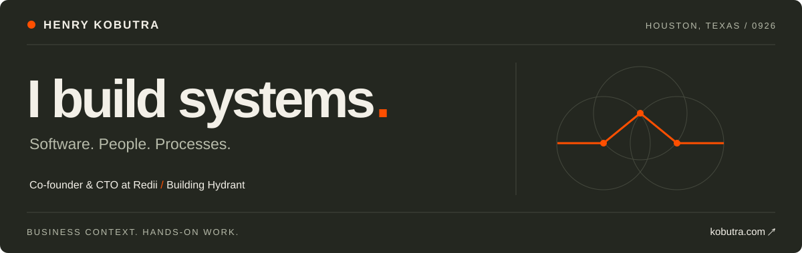

**Technology and AI product leader · Co-founder & CTO at Redii · Houston, Texas**

I lead product and engineering in regulated industries, and I still build. Most of my recent work lives in private repositories, so here's what's in them.

## Now

**[Redii](https://www.redii.co/)**: co-founded the company and built its global employee-benefits platform as CTO of a three-person team: 10 languages, 150+ countries, setup in about an hour.

- 2,300+ merged pull requests since February 2026, directing a team of AI coding agents alongside the human team
- A 43-tool MCP server that gives AI assistants permission-scoped access to benefits, retirement and payroll data
- 730+ automated test files, 28 end-to-end journeys and CI gates for types, access control, dependencies and assistant evals

**[Hydrant](https://hydrant.dev/)**: an issue tracker for people who work with AI agents. 860+ merged pull requests in ten weeks.

## Before

- **SVP, Head of Digital Business Innovation, Principal Financial Group (Thailand business)**: cut app development cost by about 50% (roughly $300K), took app NPS from -36 to +11 and nearly doubled retirement-app conversion
- **VP, Digital Business Strategy, TISCO Financial Group**: launched banking, lending and retirement apps and 10 corporate sites; manager to VP in under a year
- **Director of Product, Mayan**: dashboard engagement up 180%; led research and UX for an ML ad-bidding product

## Writing

I write practical guides about building systems, reviewing agent work, and making engineering decisions.

- [How to check an agent's work before accepting it](https://www.kobutra.com/notes/check-an-agents-work/)
- [A small patch can fix the wrong place](https://www.kobutra.com/notes/review-the-change/)
- [Give coding agents the same project context](https://www.kobutra.com/notes/shared-project-context/)

[All notes →](https://www.kobutra.com/notes/) · [Tools I use →](https://www.kobutra.com/uses/)

## Education & certifications

MBA in IT Management and BS in IT (Western Governors University) · AAS in Artificial Intelligence (Houston City College) · PMP, CEH, CPTS, PNPT

---

[Website](https://www.kobutra.com/) · [LinkedIn](https://www.linkedin.com/in/henrykobutra)

<!-- Hello, fellow source reader. The interesting part is how the pieces fit together. -->
